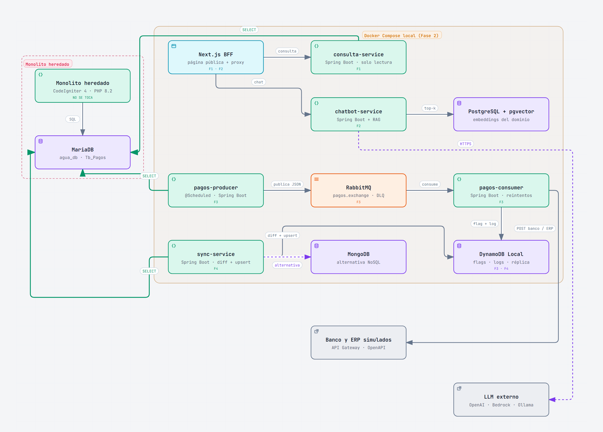
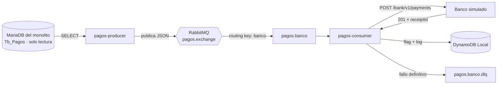
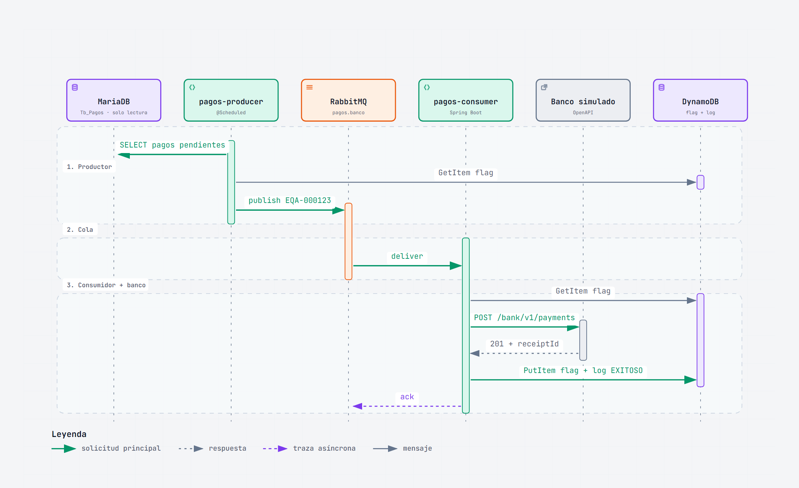
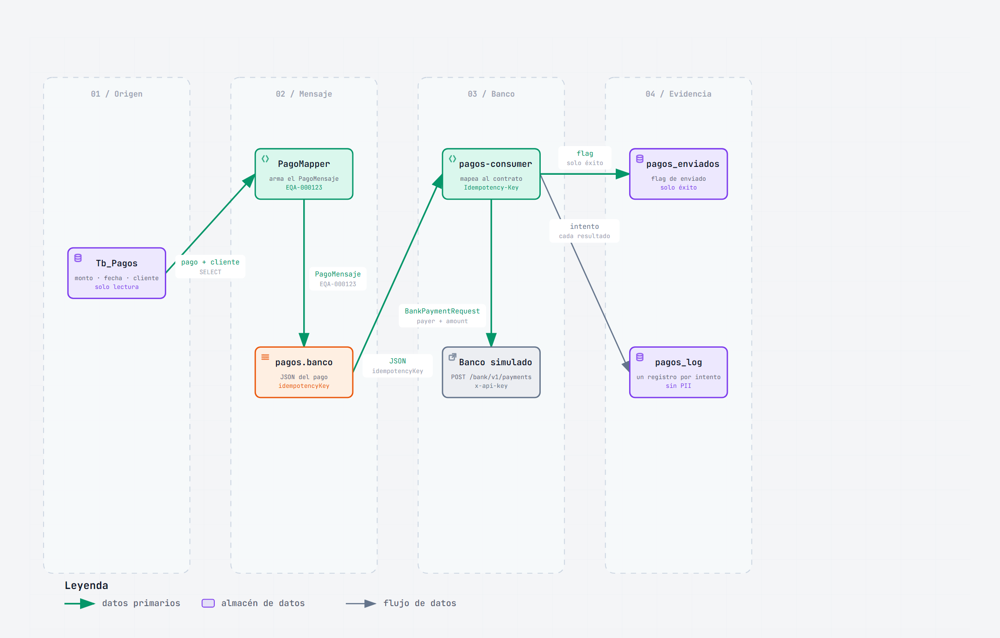

Nombre: Mario Fernando Cerna Nájera
Carnet: 0905-23-5025
Repositorio: https://github.com/Grupo-1-Sistema-de-agua/ApiBanco
Modulo asignado: Envío de pagos a sistemas externos por colas

# Oficina del Agua — Fase 2 · Feature 3

Este repositorio contiene **mi módulo de la Fase 2**: el envío de los pagos
registrados en el monolito hacia sistemas externos (banco y ERP) usando una
cola de mensajes. Incluye el productor, el consumidor, RabbitMQ, el registro de
flags y logs en DynamoDB y la documentación de la arquitectura integrada.

> **Alcance del repositorio:** aquí está implementada la **Feature 3** completa.
> Las Features 1, 2 y 4 son módulos de otros integrantes del equipo; en este
> documento se explica su papel y cómo se integran, pero su código no vive en
> este repositorio. El `docker-compose.yml` de aquí levanta la porción de la
> Feature 3; el equipo integra las cuatro features en un compose común.

---

## 1. Arquitectura de la solución integrada

La Fase 2 parte del **monolito heredado** (CodeIgniter 4 + MariaDB) y le agrega
cuatro features. El monolito **no se modifica**: los servicios nuevos lo leen
con un usuario de solo lectura. Todo corre localmente en Docker Compose; la
única llamada externa real es el LLM del chatbot.

El monolito está en
[`Grupo-1-Sistema-de-agua/Sistema_Oficina_De_Agua`](https://github.com/Grupo-1-Sistema-de-agua/Sistema_Oficina_De_Agua);
este repositorio no lo modifica.



> Diagrama elaborado con **Archify** a partir de la arquitectura de Fase 2 y del
> código real de la Feature 3. Fuente editable:
> [`docs/diagramas/arquitectura-fase2.architecture.json`](docs/diagramas/arquitectura-fase2.architecture.json).

### 1.1 Componentes

| Componente | Tecnología | Responsabilidad | ¿Está en este repo? |
|---|---|---|---|
| **Monolito heredado** | CodeIgniter 4 · PHP 8.2 | Auth, clientes, contadores, lecturas, pagos y recibos. Es la fuente de verdad. | No (repo aparte) |
| **MariaDB** | MariaDB 10.11 · `agua_db` | Base del monolito. Los servicios nuevos solo hacen `SELECT`. | No |
| **Next.js BFF** | Next.js | Página pública, captcha y proxy del chatbot. Nunca accede a la base directamente. | No (Feature 1/2) |
| **consulta-service** | Spring Boot | Consulta el estado de cuenta con el código del contador; rate limit por IP. | No (Feature 1) |
| **chatbot-service** | Spring Boot + RAG | Genera embeddings, busca en pgvector y arma el prompt para el LLM. | No (Feature 2) |
| **PostgreSQL + pgvector** | PostgreSQL + pgvector | Almacena los embeddings del contenido del dominio. | No (Feature 2) |
| **pagos-producer** | Spring Boot · `@Scheduled` | Lee los pagos pendientes y publica un mensaje por destino en RabbitMQ. | **Sí (Feature 3)** |
| **RabbitMQ** | RabbitMQ 3 Management | Cola `pagos.banco`, exchange `pagos.exchange` y DLQ `pagos.banco.dlq`. | **Sí (Feature 3)** |
| **pagos-consumer** | Spring Boot · OpenFeign | Consume el mensaje, llama al banco/ERP, reintenta fallos temporales y registra flag + log. | **Sí (Feature 3)** |
| **DynamoDB Local** | AWS SDK v2 | Tablas `pagos_enviados` (flag) y `pagos_log` (historial de intentos). | **Sí (Feature 3)** |
| **sync-service** | Spring Boot | Replicación asíncrona con `diff + upsert`; nunca borra registros. | No (Feature 4) |
| **MongoDB** | MongoDB | Destino NoSQL alternativo de la replicación. | No (Feature 4) |
| **Banco y ERP simulados** | API Gateway + OpenAPI | Sistemas externos del docente; se consumen con su contrato tal cual. | No (los provee el docente) |
| **LLM externo** | OpenAI / Bedrock / Ollama | Responde el chatbot; la API key nunca llega al navegador. | No (servicio externo) |

### 1.2 Conexiones y flujos

| Origen → destino | Protocolo / mecanismo | Para qué |
|---|---|---|
| Monolito → MariaDB | SQL | Operación normal del monolito |
| consulta-service → MariaDB | JDBC `SELECT` | Consulta pública de estado de cuenta |
| pagos-producer → MariaDB | JDBC `SELECT` | Detecta pagos pendientes |
| sync-service → MariaDB | JDBC `SELECT` | Calcula el diff para la réplica |
| Next.js → consulta-service | HTTP/JSON | Consulta pública con captcha |
| Next.js → chatbot-service | HTTP/JSON | Chatbot; el navegador no ve la API key |
| chatbot-service → pgvector | SQL | Búsqueda de embeddings (top-k) |
| chatbot-service → LLM | HTTPS | Generación de la respuesta |
| pagos-producer → RabbitMQ | AMQP | Publica el mensaje del pago |
| RabbitMQ → pagos-consumer | AMQP | Entrega el mensaje al consumidor |
| pagos-consumer → banco/ERP | HTTPS · OpenAPI | `POST` del pago al sistema externo |
| pagos-consumer → DynamoDB | AWS SDK | Flag de enviado y log de cada intento |
| sync-service → DynamoDB / MongoDB | AWS SDK / driver | `diff + upsert` de la réplica |

### 1.3 Fronteras y reglas de integración

- **El monolito no se toca:** ni su esquema ni sus datos. El productor y los
  demás servicios usan un usuario con `GRANT SELECT` y `ddl-auto: validate`.
- **Next.js no accede a la base:** actúa como BFF y llama a los microservicios.
- **La API key del LLM no se expone al navegador:** vive en el servidor.
- **Las colas se procesan con los componentes reales:** productor, RabbitMQ y
  consumidor; no hay un envío síncrono escondido desde el monolito.
- **Idempotencia:** un pago no se envía dos veces al mismo destino aunque el
  mensaje se reprocese.
- **Trazabilidad:** el flag responde “¿ya se envió?” y el log responde “¿qué
  pasó en cada intento?”.

### 1.4 Cómo se ejecuta la solución integrada

El equipo integra las cuatro features en un **`docker-compose.yml` común** con:
Next.js, los microservicios Spring Boot (`consulta-service`, `chatbot-service`,
`pagos-producer`, `pagos-consumer`, `sync-service`), PostgreSQL + pgvector,
RabbitMQ, DynamoDB Local y MongoDB. El monolito queda fuera del compose (o en
su propio compose) y se conecta por red.

Este repositorio conserva su propio `docker-compose.yml` para levantar y probar
**solo la Feature 3** sin depender de los otros módulos. Los pasos exactos están
en la sección 2.4.

---

## 2. Mi módulo: envío de pagos por colas (Feature 3)

### 2.1 Funcionalidad y objetivo

La Oficina del Agua registra los pagos en el monolito, pero notificarlos al
banco (y al ERP) de forma síncrona es frágil: si el sistema externo está caído,
el pago se pierde o queda a medias; si se reintenta a ciegas, se puede cobrar
dos veces. La Feature 3 resuelve ese problema con una **cola de mensajes** y un
**flag de idempotencia**.

Flujo:



1. El **productor** corre cada 15–30 s, lee los pagos no anulados y omite los
   que ya tienen flag.
2. Publica un mensaje por pago en `pagos.exchange` con routing key `banco`.
3. El **consumidor** mapea el mensaje al contrato OpenAPI del banco y hace el
   `POST` con la clave de idempotencia.
4. Si el banco responde `201` (o `409 DUPLICATE_PAYMENT`), guarda el **flag** y
   un log `EXITOSO`. Si falla, guarda un log `FALLIDO`.
5. Los fallos temporales se reintentan; los definitivos van a la **DLQ** y el
   pago queda sin flag para poder reenviarlo después.

### 2.2 Integración y responsabilidades

| Componente | Cómo se integra | Frontera / decisión |
|---|---|---|
| **MariaDB del monolito** | `SELECT` sobre `Tb_Pagos`, `Tb_Lecturas`, `Tb_Contadores`, `Tb_Clientes` y `Tb_Metodos_Pago` | Solo lectura; usuario `agua_ro`; `read-only: true`; `ddl-auto: validate`. No se agregan columnas ni endpoints al monolito. |
| **RabbitMQ** | Exchange directo `pagos.exchange`, cola durable `pagos.banco`, DLX `pagos.dlx` y DLQ `pagos.banco.dlq` | Desacopla el monolito del banco; si el banco falla, el mensaje no se pierde. |
| **Banco simulado** | `POST /bank/v1/payments` con `x-api-key`, `Idempotency-Key` y `X-Correlation-Id` | Contrato del docente; no se modifica. `201` y `409 DUPLICATE_PAYMENT` son éxito. |
| **ERP simulado** | Mismo patrón, otro destino | La arquitectura de Fase 2 lo contempla; la implementación actual de este repositorio entrega al **banco**. El ERP queda como extensión si el docente lo exige. |
| **DynamoDB Local** | `pagos_enviados` (flag) y `pagos_log` (un registro por intento) | Vive fuera del monolito; no guarda `fullName` ni `taxId`. |
| **Otros módulos** | Comparten la red de Docker y la lectura del monolito | No hay dependencia directa: la Feature 3 no llama a Next.js ni al chatbot. |

**Por qué estas fronteras:** el monolito es el sistema aprobado de Fase 1 y no
se puede romper; la cola absorbe los picos y las caídas del banco; el flag vive
en un almacén propio de la Fase 2 para no alterar el esquema heredado; y cada
consumidor es responsable de un destino, lo que permite agregar el ERP sin
tocar al productor.

### 2.3 Decisión técnica

**Decisión: idempotencia con una clave estable (`EQA-000123`) y un flag en
DynamoDB, más tolerancia al `409 DUPLICATE_PAYMENT` del banco.**

Alternativas consideradas:

| Alternativa | Por qué no se eligió |
|---|---|
| Agregar `enviado_a_banco` a `Tb_Pagos` | Prohibido: modifica el esquema del monolito y acopla la Fase 2 a su base. |
| Confiar solo en la idempotencia del banco | Un timeout puede ocurrir **después** de que el banco aceptó el pago (`LOST_ACK`); sin flag local se reintentaría sin saber si ya se entregó. |
| Llamar al banco desde el monolito | Si el banco está caído, el pago se pierde o bloquea la operación; no hay cola que absorba el fallo. |
| Reintentar todos los errores | Un `400`/`422` es un error de datos: reintentarlo 5 veces solo llena la cola y retrasa la DLQ. |

La política de reintentos quedó así:

- **Reintentar:** `429`, `5xx`, timeout/sin respuesta (`BancoReintentableException`).
- **No reintentar:** `400`, `403`, `422` y `409 IDEMPOTENCY_KEY_REUSED` → DLQ.
- **5 intentos** con espera de 1, 2, 4 y 8 segundos.
- **Flag solo en éxito:** si se agotan los intentos, no hay flag y el pago se
  puede volver a publicar.
- **Historial completo:** cada intento queda en `pagos_log`; al recuperarse, el
  contador continúa (por ejemplo, intento 6).

> Spring Boot 3.5 ya no tiene `retryable-exceptions`; por eso la política vive
> en `pagos-consumer-banco/.../config/RetryConfig.java` con `SimpleRetryPolicy`.

### 2.4 Cómo probar el módulo

#### Requisitos previos

- Docker Desktop encendido.
- La API key del banco (la entrega el docente) en `.env`; **no** se sube al
  repositorio.
- **Opción A (flujo completo):** la MariaDB del monolito con datos de prueba,
  accesible desde Docker en `host.docker.internal:3307` y un usuario de solo
  lectura. El compose del monolito publica `3306` por defecto; este compose
  espera `3307`. Si tu MariaDB está en `3306`, cambia el mapeo o `DB_URL` en
  `docker-compose.yml`.
- **Opción B (solo consumidor):** no necesitas el monolito; publicas un mensaje
  a mano desde la consola de RabbitMQ.

#### Preparar el entorno

```bat
cd C:\Users\mario\Desktop\ApiBanco
copy .env.example .env
```

Edita `.env` con tus valores (sin commitearlo):

```env
BANK_BASE_URL=https://TU_API_ID.execute-api.us-east-1.amazonaws.com/prod
BANK_API_KEY=tu_api_key
BANK_SCENARIO=SUCCESS
TEAM_CODE=EQUIPO_A
DB_USER=agua_ro
DB_PASSWORD=tu_password_de_solo_lectura
PRODUCER_LIMITE=20
PRODUCER_INTERVALO_MS=30000
```

Levanta la Feature 3:

```bat
docker compose up -d --build
docker compose ps
```

| Servicio | URL / puerto |
|---|---|
| RabbitMQ (consola) | http://localhost:15672 — `guest` / `guest` |
| DynamoDB Local | http://localhost:8000 |
| pagos-consumer | http://localhost:8082 |
| pagos-producer | http://localhost:8081 |
| MariaDB del monolito | `localhost:3307` (solo lectura) |

#### Prueba 1 — Flujo automático (con monolito)

```bat
docker compose logs -f pagos-producer
```

En unos segundos debe aparecer:

```
Publicado en RabbitMQ: key=EQA-0000XX paymentId=XX monto=... canal=...
```

En otra terminal:

```bat
docker compose logs -f pagos-consumer
```

Resultado esperado:

```
Pago recibido: paymentId=XX idempotencyKey=EQA-0000XX
Flag guardado en DynamoDB: EQA-0000XX -> enviado
Log guardado en DynamoDB: EQA-0000XX intento=1 estado=EXITOSO
ENTREGADO al banco. receiptId=BNK-...
```

#### Prueba 2 — Solo consumidor (sin monolito)

```bat
docker compose stop pagos-producer
docker compose up -d rabbitmq dynamodb-local pagos-consumer
```

En **http://localhost:15672** → *Queues and Streams* → `pagos.banco` →
*Publish message*, usa `content_type = application/json` y este payload:

```json
{
  "idempotencyKey": "EQA-DEMO-001",
  "paymentId": 999001,
  "customerCode": "CLI-0001",
  "fullName": "Cliente de Prueba",
  "taxId": "CF",
  "amount": "125.50",
  "transactionDate": "2026-10-24T10:00:00-06:00",
  "channel": "CASH",
  "description": "Servicio de agua 2026-10"
}
```

> `fullName` es obligatorio (máximo 150 caracteres). Si falta, el banco
> responde `400 VALIDATION_ERROR`.

Resultado esperado en el log del consumidor:

```
Pago recibido: paymentId=999001 idempotencyKey=EQA-DEMO-001
Flag guardado en DynamoDB: EQA-DEMO-001 -> enviado
Log guardado en DynamoDB: EQA-DEMO-001 intento=1 estado=EXITOSO
ENTREGADO al banco. receiptId=BNK-...
```

#### Prueba 3 — Idempotencia (no se envía dos veces)

Publica **el mismo JSON** otra vez. El consumidor debe responder:

```
El pago EQA-DEMO-001 ya estaba enviado al banco. Se ignora.
```

No hay llamada al banco, no se duplica el flag y la cola queda en 0.

#### Prueba 4 — Fallo temporal (500) → reintentos → DLQ

En `.env`:

```env
BANK_SCENARIO=ERROR_500
```

Recrea **solo** el consumidor (un `restart` no recarga `.env`):

```bat
docker compose up -d --force-recreate pagos-consumer
```

Publica un mensaje con una clave nueva (`EQA-DEMO-FAIL`) y espera ~25 s. Si esa
clave ya tiene flag de un ensayo anterior, usa otra (por ejemplo
`EQA-DEMO-FAIL-2`) o borra su flag antes de publicar:

```
Log guardado en DynamoDB: EQA-DEMO-FAIL intento=1 estado=FALLIDO
...
Log guardado en DynamoDB: EQA-DEMO-FAIL intento=5 estado=FALLIDO
Rechazo ... -> cola de errores
```

Verifica la DLQ y que **no** hay flag:

```bat
docker exec rabbitmq rabbitmqctl list_queues name messages
```

```
pagos.banco.dlq   1
pagos.banco       0
```

#### Prueba 5 — Error de datos (400) → un solo intento → DLQ

Vuelve a `.env` con `BANK_SCENARIO=SUCCESS`, recrea el consumidor y publica un
pago con una clave nueva y `fullName` de más de 150 caracteres:

```bat
docker compose up -d --force-recreate pagos-consumer
```

```
Log guardado en DynamoDB: EQA-... intento=1 estado=FALLIDO
Rechazo del banco. status=400 code=VALIDATION_ERROR -> cola de errores
```

Un `400` **no** se reintenta: va directo a la DLQ.

#### Prueba 6 — Recuperación

Vuelve a `.env`:

```env
BANK_SCENARIO=SUCCESS
```

Recrea el consumidor y republica **la misma clave** que usaste en la prueba 4:

```bat
docker compose up -d --force-recreate pagos-consumer
```

Resultado esperado:

```
Flag guardado en DynamoDB: EQA-DEMO-FAIL -> enviado
Log guardado en DynamoDB: EQA-DEMO-FAIL intento=6 estado=EXITOSO
ENTREGADO al banco. receiptId=BNK-...
```

El contador sigue en 6: el historial se conservó y ahora sí hay flag.

#### Prueba 7 — Evidencia en DynamoDB y conciliación

```bat
docker run --rm -e AWS_ACCESS_KEY_ID=dummy -e AWS_SECRET_ACCESS_KEY=dummy ^
  amazon/aws-cli dynamodb scan --table-name pagos_enviados ^
  --endpoint-url http://host.docker.internal:8000 --region us-east-1
```

Busca `"idempotencyKey": {"S": "EQA-DEMO-001"}` y
`"enviado": {"BOOL": true}`.

Con el script de QA:

```powershell
powershell -NoProfile -ExecutionPolicy Bypass -File .\scripts\conciliar.ps1
```

Resultado esperado: `RESULTADO: CONCILIADO`. El script compara flags contra
logs y detecta flag sin log, log sin flag o `receiptId` distinto.

#### Limpieza

```bat
docker exec rabbitmq rabbitmqctl purge_queue pagos.banco.dlq
docker compose down
```

`docker compose down` conserva los datos en volúmenes; usa `down -v` solo si
quieres borrar flags y logs.

### 2.5 Diagramas de apoyo

**Secuencia del camino feliz:** productor → MariaDB → RabbitMQ → consumidor →
banco → flag/log.



> Fuente editable:
> [`docs/diagramas/feature3-secuencia.sequence.json`](docs/diagramas/feature3-secuencia.sequence.json).

**Datos e idempotencia:** qué viaja al banco y qué se guarda como evidencia.



> Fuente editable:
> [`docs/diagramas/feature3-datos.dataflow.json`](docs/diagramas/feature3-datos.dataflow.json).

Las variantes de error (duplicado, 500, 400 y recuperación) están en el
diagrama de estados y en el de actividades de
[`docs/diagramas.md`](docs/diagramas.md).

---

## 3. Ejecución de este repositorio

### 3.1 Variables de entorno

| Variable | Uso |
|---|---|
| `BANK_BASE_URL` | URL del banco simulado |
| `BANK_API_KEY` | API key del banco (solo en `.env`) |
| `BANK_SCENARIO` | `SUCCESS` o `ERROR_500` para la demo |
| `TEAM_CODE` | Código del equipo (`EQUIPO_A`) |
| `DB_USER` / `DB_PASSWORD` | Usuario de solo lectura de MariaDB |
| `PRODUCER_LIMITE` | Pagos nuevos por ciclo |
| `PRODUCER_INTERVALO_MS` | Intervalo del `@Scheduled` |

### 3.2 Comandos

```bat
copy .env.example .env
:: completar .env
docker compose up -d --build
docker compose logs -f pagos-producer
docker compose logs -f pagos-consumer
```

Para detener:

```bat
docker compose down
```

> Si cambiaste código, usa `docker compose up -d --build`. Si solo cambiaste
> `.env`, recrea el servicio afectado con `--force-recreate`.

---

## 4. Estructura del repositorio

```
ApiBanco/
├─ README.md
├─ README-palabras-clave.md
├─ api-bancos-feature3.md
├─ docker-compose.yml
├─ .env.example                 # plantilla sin secretos
├─ docs/
│  ├─ arquitectura.md           # arquitectura integrada en detalle
│  ├─ diagramas/
│  │  ├─ README.md              # cómo regenerar los diagramas
│  │  ├─ arquitectura-fase2.png
│  │  ├─ arquitectura-fase2.architecture.json
│  │  ├─ feature3-secuencia.png
│  │  ├─ feature3-secuencia.sequence.json
│  │  ├─ feature3-datos.png
│  │  └─ feature3-datos.dataflow.json
│  ├─ pruebas-e2e.md            # 5 escenarios y evidencia
│  ├─ ensayo.md                 # ensayo general y checklist
│  ├─ seguridad.md              # credenciales, permisos y datos
│  ├─ conciliacion.md           # script de QA
│  ├─ datos-prueba.md           # origen y mapeo de datos
│  └─ diagramas.md              # diagramas Mermaid de la Feature 3
├─ scripts/
│  └─ conciliar.ps1
├─ pagos-producer/              # lee MariaDB y publica en RabbitMQ
└─ pagos-consumer-banco/        # consume, llama al banco y guarda flag/log
```

---

## 5. Documentación adicional

- [Arquitectura integrada en detalle](docs/arquitectura.md)
- [Pruebas E2E y evidencia](docs/pruebas-e2e.md)
- [Ensayo general](docs/ensayo.md)
- [Seguridad y configuración](docs/seguridad.md)
- [Conciliación de pagos](docs/conciliacion.md)
- [Datos de prueba](docs/datos-prueba.md)
- [Diagramas de la Feature 3](docs/diagramas.md)
- [Secuencia y dataflow (Archify)](docs/diagramas/README.md)
- [Palabras clave y preguntas de defensa](README-palabras-clave.md)
- [Notas del contrato del banco](api-bancos-feature3.md)

---

## 6. Seguridad de la información

- Las credenciales viven en `.env`, que está en `.gitignore`; el repositorio
  solo incluye `.env.example` con placeholders.
- La API key del banco se envía en el header `x-api-key` desde el servidor;
  nunca se escribe en el README, en el código ni en capturas.
- Los logs no incluyen `fullName` ni `taxId`; DynamoDB guarda solo claves,
  intentos, estados, códigos y recibos.
- `server.error.include-stacktrace: never` en ambos servicios.
- Verificación rápida:

```bat
git check-ignore -v .env
git log --all --oneline -- .env
```

El primer comando debe mostrar la regla de `.gitignore`; el segundo no debe
devolver nada (el `.env` nunca se commiteó).

---

## 7. Checklist de entrega

- [x] El README comienza con `Nombre:`, `Carnet:`, `Repositorio:` y `Modulo asignado:`.
- [x] El enlace del campo `Repositorio:` es el mismo que se entrega en la plataforma.
- [x] Arquitectura de la solución integrada documentada y con diagrama visible.
- [x] Módulo documentado: objetivo, integración, decisión técnica y pruebas.
- [x] Procedimiento de ejecución y pruebas reproducible.
- [x] Sin contraseñas, tokens, API keys ni `.env` en el repositorio ni en el historial de Git.
- [x] Repositorio público.
- [ ] Publicar únicamente el enlace del repositorio en la plataforma.
- [ ] Abrir el enlace en una ventana privada y verificar README, diagrama y código.
