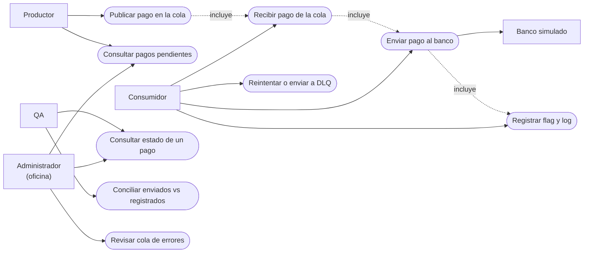
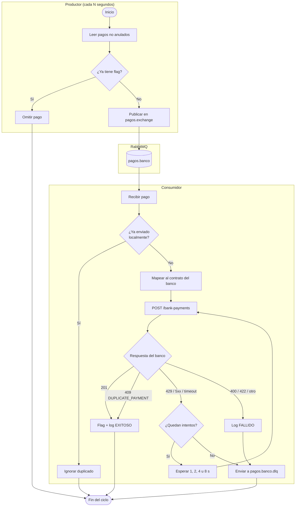
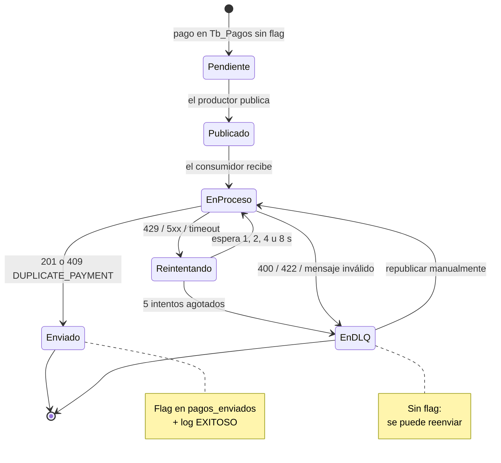
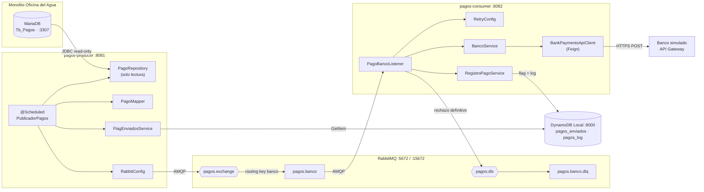

# Diagramas — Feature 3 (SDGA-104)

Diagramas de la solución: **casos de uso**, **actividades**, **estados** y
**componentes**. Están en Mermaid para que GitHub los renderice directamente.

> Versiones en imagen (Archify): [secuencia](diagramas/feature3-secuencia.png)
> y [dataflow](diagramas/feature3-datos.png).

Contexto: los pagos pendientes del monolito viajan por RabbitMQ, el consumidor
los envía al banco simulado y se guarda un flag + log en DynamoDB.

---

## 1. Casos de uso

Actores y acciones que cubre la feature.



**Lectura:**
- El **productor** consulta y publica; no llama al banco.
- El **consumidor** recibe, envía, registra y decide reintentos.
- El **administrador** y **QA** solo consultan (no hay interfaz propia: se usan
  logs, RabbitMQ y DynamoDB).

---

## 2. Actividades

Flujo completo, desde la lectura del pago hasta el flag o la DLQ.



**Reglas que representa:**
- Un pago con flag se omite antes de publicar.
- Un duplicado local se ignora **sin** llamar al banco.
- `201` y `409 DUPLICATE_PAYMENT` se consideran éxito.
- Solo `429`, `5xx` y timeout se reintentan (5 intentos).
- `400/422` y mensajes inválidos van directo a la DLQ.
- La DLQ **no** escribe flag: el pago puede reenviarse.

---

## 3. Estados de un pago

Ciclo de vida desde que está pendiente hasta que se envía o queda en la DLQ.



**Invariante clave:** el flag se escribe **solo** en `Enviado`. Si el pago
termina en `EnDLQ`, no hay flag y el productor lo volverá a publicar en otro
ciclo (o se republica a mano).

---

## 4. Componentes

Piezas desplegadas y cómo se comunican.



**Notas:**
- El productor **solo lee** MariaDB (`read-only: true`) y **solo lee** el flag
  en DynamoDB.
- El consumidor es el único que escribe en DynamoDB.
- RabbitMQ desacopla productor y consumidor; la DLX/DLQ captura lo irrecuperable.
- El banco es externo (API Gateway) y se llama por HTTPS con el cliente Feign.

---

## 5. Cómo visualizarlos

- **GitHub:** los bloques `mermaid` se renderizan solos al abrir este archivo.
- **VS Code:** instalar la extensión *Markdown Preview Mermaid Support* y abrir
  la vista previa.
- **Mermaid Live Editor:** https://mermaid.live (pegar cada bloque).

> Si un diagrama no renderiza, revisa que el bloque empiece con
> ```` ```mermaid ```` y termine con ```` ``` ````.
